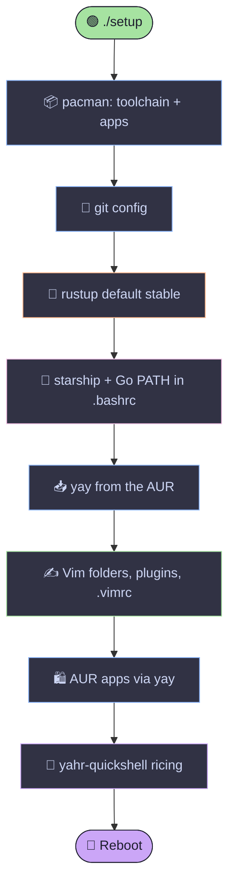

<div align="center">


<a href="https://github.com/roland-yegon/config-files">
  
</a>

<br/>


</div>

<br/>

```text
     ╭──────────────────────────────────────────────╮
     │   ░█▀▀░█▀█░█▀█░█▀▀░▀█▀░█▀▀░░░█▀▀░▀█▀░█░░░█▀▀  │
     │   ░█░░░█░█░█░█░█▀▀░░█░░█░█░░░█▀▀░░█░░█░░░█▀▀  │
     │   ░▀▀▀░▀▀▀░▀░▀░▀░░░▀▀▀░▀▀▀░░░▀░░░▀▀▀░▀▀▀░▀▀▀  │
     ╰──────────────────────────────────────────────╯
        my entire desktop, in a folder. you're welcome.
```

## 📖 Table of Contents

- [✨ What is this?](#-what-is-this)
- [🚀 Quick start](#-quick-start)
- [🧬 What the script does](#-what-the-script-does)
- [📦 What gets installed](#-what-gets-installed)
- [⌨️ Vim cheat sheet](#️-vim-cheat-sheet)
- [🎨 Palette](#-palette)
- [🗂️ Repo layout](#️-repo-layout)
- [🩹 Troubleshooting](#-troubleshooting)
- [📜 License](#-license)

<br/>

## ✨ What is this?

My personal dotfiles and post-install bootstrap for **Arch Linux**. I break my system on a regular basis, so instead of rebuilding my setup from memory every time, one script now does it for me.

| | |
|---|---|
| 🛠️ **Toolchain** | Go, Rust, C/C++ (cmake, ninja, gdb) |
| ✍️ **Editor** | Vim, hand-tuned, plugins through native packages (no plugin manager) |
| 🖥️ **Desktop** | Hyprland, riced with [yahr-quickshell](https://github.com/bgibson72/yahr-quickshell) |
| 🐚 **Shell** | Bash + [Starship](https://starship.rs) |
| 🎨 **Theme** | Catppuccin Mocha, everywhere it can possibly fit |

<br/>

## 🚀 Quick start

> [!WARNING]
> This is built for a **fresh Arch install** with `sudo` set up and a normal (non-root) user. It's safe to re-run, but read the script first. Never pipe a stranger's script into your shell, and that includes me.

**1. Make sure `git` is there:**

```bash
sudo pacman -S --needed git
```

**2. Clone the repo:**

```bash
git clone https://github.com/roland-yegon/config-files.git
cd config-files
```

**3. Run it:**

```bash
./setup
```

**4. Reboot when it asks, and enjoy.** ☕

<br/>

## 🧬 What the script does



**Nice touches:**

- 🔁 **Idempotent.** Run it twice, nothing explodes. Plugins update, `.bashrc` lines never duplicate, and `yay` is skipped if it's already installed.
- 💾 **Non-destructive.** An existing `.vimrc` gets backed up to `~/.vimrc.bak` first.
- 🛡️ **Won't run as root.** It checks, and it refuses.
- 🧹 **Cleans up after itself.** Temp clones live in a throwaway directory.
- 🩹 **Fails gracefully.** One broken AUR package won't take the whole script down.

<br/>

## 📦 What gets installed

<details open>
<summary><b>🔨 Dev toolchain</b></summary>
<br/>

| Package | Why |
|---|---|
| `base-devel` `cmake` `ninja` | Build everything |
| `go` | Main backend language 🐹 |
| `rustup` | Rust, stable channel 🦀 |
| `gdb` | Debugging, so I can suffer in style |
| `git` | You know why |
| `gvim` | Vim with clipboard support (`+clipboard`) |
| `fzf` `ripgrep` | Fuzzy file and text search inside Vim |

</details>

<details>
<summary><b>🧰 CLI quality of life</b></summary>
<br/>

| Package | Why |
|---|---|
| `starship` | The prompt |
| `btop` | Prettiest task manager there is |
| `fastfetch` | For screenshots and bragging rights |
| `man-db` `man-pages` `tldr` | RTFM, but short |
| `plocate` | Instant file search |
| `ttf-jetbrains-mono-nerd` | Icons that don't render as tofu boxes |

</details>

<details>
<summary><b>🖼️ Desktop apps</b></summary>
<br/>

| Source | Packages |
|---|---|
| **Official repos** | `obs-studio` `libreoffice-still` `okular` `mpv` `gwenview` `discord` `qtcreator` |
| **AUR (via yay)** | `spotify-bin` `brave-bin` `google-chrome` `visual-studio-code-bin` `eclipse-java-bin` `anydesk-bin` |

</details>

<details>
<summary><b>🔌 Vim plugins</b></summary>
<br/>

Installed with Vim's native `pack/` system, so there's no plugin manager and nothing to break.

| Plugin | What it does |
|---|---|
| [catppuccin/vim](https://github.com/catppuccin/vim) | The theme 🎨 |
| [itchyny/lightline.vim](https://github.com/itchyny/lightline.vim) | Slick status line |
| [junegunn/fzf.vim](https://github.com/junegunn/fzf.vim) | Fuzzy finder everything |
| [LunarWatcher/auto-pairs](https://github.com/LunarWatcher/auto-pairs) | Brackets that close themselves |

</details>

<br/>

## ⌨️ Vim cheat sheet

> **Leader key:** `Space`

### 🧭 Files, buffers & search

| Keys | Action |
|:---:|---|
| `␣ w` | 💾 Save |
| `␣ q` | 🚪 Quit |
| `␣ e` | 🌳 Toggle file explorer |
| `␣ f` | 🔍 Fuzzy find files |
| `␣ g` | 🔎 Live grep with ripgrep |
| `␣ b` | 📑 Switch buffer |
| `␣ h` | 🕓 File history |
| `␣ n` / `␣ p` | ⏭️ Next / previous buffer |
| `␣ d` | 🗑️ Close buffer |

### ⚡ Editing

| Keys | Action |
|:---:|---|
| `Y` | Yank to end of line (consistent with `D` and `C`) |
| `J` / `K` *(visual)* | Move the selected lines down / up |
| `<` / `>` *(visual)* | Indent and keep the selection |
| `Ctrl + L` | Clear search highlight |
| `Ctrl + H` `J` `K` | Jump between splits |

<br/>

## 🎨 Palette

Everything follows **Catppuccin Mocha**.

| Swatch | Name | Hex |
|:---:|---|---|
|  | Base | `#1e1e2e` |
|  | Mauve | `#cba6f7` |
|  | Pink | `#f5c2e7` |
|  | Blue | `#89b4fa` |
|  | Green | `#a6e3a1` |
|  | Peach | `#fab387` |
|  | Text | `#cdd6f4` |

<!--
📸 SCREENSHOTS: add yours here once you have them!

## 📸 Screenshots

<div align="center">
  
  
</div>
-->

<br/>

## 🗂️ Repo layout

```text
config-files/
├── 📜 setup       # The one script to rule them all
├── 🎹 .vimrc      # Vim config (Catppuccin, fzf, lightline)
└── 📖 README.md   # You are here
```

<br/>

## 🩹 Troubleshooting

<details>
<summary><b>Icons show up as empty boxes</b></summary>
<br/>

Set your terminal's font to **JetBrainsMono Nerd Font**. The script installs it, but your terminal still has to be told to use it.

</details>

<details>
<summary><b>Vim complains about colorscheme or plugins</b></summary>
<br/>

Check that the plugins landed in the right place:

```bash
ls ~/.vim/pack/*/start/
```

You should see `catppuccin`, `lightline`, `fzf.vim` and `auto-pairs`.

</details>

<details>
<summary><b>An AUR package failed to install</b></summary>
<br/>

The script warns and keeps going. Install the failed one manually:

```bash
yay -S <package-name>
```

</details>

<details>
<summary><b>`starship` isn't showing up in my prompt</b></summary>
<br/>

Open a new terminal, or reload the config:

```bash
source ~/.bashrc
```

</details>

<br/>

## 📜 License

Do whatever you want with it. If it nukes your system, that's between you and your backups. 💀

<br/>

<div align="center">

**Made with 💜 and way too much caffeine by [Roland](https://github.com/roland-yegon)**

<sub>⭐ Star it if it saved you an afternoon of reinstalling things ⭐</sub>


</div>
