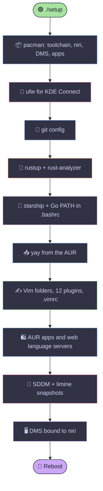

<div align="center">


<a href="https://github.com/roland-yegon/config-files">
  
</a>

<br/><br/>


<br/><br/>


</div>

<br/>

```text
     ╭──────────────────────────────────────────────╮
     │   ░█▀▀░█▀█░█▀█░█▀▀░▀█▀░█▀▀░░░█▀▀░▀█▀░█░░░█▀▀  │
     │   ░█░░░█░█░█░█░█▀▀░░█░░█░█░░░█▀▀░░█░░█░░░█▀▀  │
     │   ░▀▀▀░▀▀▀░▀░▀░▀░░░▀▀▀░▀▀▀░░░▀░░░▀▀▀░▀▀▀░▀▀▀  │
     ╰──────────────────────────────────────────────╯
        my entire desktop, in a folder. you're welcome.
```

## 📖 Table of Contents

- [✨ What is this?](#-what-is-this)
- [⚠️ Read this before you run it](#️-read-this-before-you-run-it)
- [🚀 Quick start](#-quick-start)
- [🧬 What the script does](#-what-the-script-does)
- [🧠 Vim, but make it an IDE](#-vim-but-make-it-an-ide)
- [🌐 Language support](#-language-support)
- [📦 What gets installed](#-what-gets-installed)
- [⌨️ Vim cheat sheet](#️-vim-cheat-sheet)
- [🪄 After the script](#-after-the-script)
- [🎨 Palette](#-palette)
- [🗂️ Repo layout](#️-repo-layout)
- [🩹 Troubleshooting](#-troubleshooting)
- [🙏 Credits](#-credits)
- [📜 License](#-license)

<br/>

## ✨ What is this?

My personal dotfiles and post-install bootstrap for **Arch Linux**. I break my system on a regular basis, so instead of rebuilding my setup from memory every time, one script now does it for me.

<table>
<tr>
<td width="50%" valign="top">

### 🛠️ Toolchain
Go, Rust, C/C++, Python, Java, Node, Qt 6, CMake, Ninja, GDB. Everything I code in, ready on first boot.

</td>
<td width="50%" valign="top">

### ✍️ Editor
Plain **Vim**, hand-tuned, with language servers, linting, snippets and word completion. All plugins are installed with native `pack/`, so there's no plugin manager.

</td>
</tr>
<tr>
<td width="50%" valign="top">

### 🖥️ Desktop
**niri** (a scrolling-tiling Wayland compositor) with **DMS** (Dux Modular Shell, formerly DankMaterialShell) as the bar, launcher, notifications and lock screen. Pretty enough to screenshot, fast enough to forget about.

</td>
<td width="50%" valign="top">

### 🎨 Theme
**Catppuccin Mocha** in Vim, fastfetch and this README. The desktop itself is themed by DMS from your wallpaper, so those colors will change with it. The Vim background is transparent so the wallpaper shows through.

</td>
</tr>
</table>

> [!NOTE]
> **No AI completion, on purpose.** Every suggestion in this Vim setup comes from a language server (type-aware, deterministic) or from words already in your open files. Nothing writes code for you. The popup suggests, you decide.

<br/>

## ⚠️ Read this before you run it

This is **my personal setup, published as-is.** It is not a generic installer. It makes choices that are right for my laptop and may be wrong for yours, and a few of them are hardcoded. Read the [`setup`](setup) script top to bottom before you run it, and edit it first.

> [!CAUTION]
> **Change these before running, or you will get my settings, not yours:**
>
> - **Git identity.** The script runs `git config --global user.name` and `user.email` with **my** name and email. Replace both, or your commits will go out as me.
> - **The SSH key helper (`./github`).** It labels the key with my email address. Edit it first.

> [!IMPORTANT]
> **Assumptions the script makes about your machine.** If any of these are false, delete or edit the matching section, because the script stops at the first error:
>
> | Assumption | What to do if it's wrong |
> |---|---|
> | **Arch Linux** with `pacman`, `sudo`, and a normal non-root user | Not portable. It will not work on other distros. |
> | **Limine bootloader + btrfs + snapper.** The script installs `limine-mkinitcpio-hook` and `limine-snapper-sync`, then runs the sync, but it does **not** install or configure `limine` or `snapper` for you | On GRUB or systemd-boot, delete the "Setting up limine" section, the two `limine-*` AUR packages and `btrfs-assistant`. |
> | **Your `/boot` is the EFI partition.** The Limine step moves `/boot/EFI/BOOT/limine.conf` aside, but only if `/boot/limine.conf` exists | Check where your ESP is mounted before you run it. If the sync does not produce `/boot/limine.conf`, the script leaves the fallback config alone and warns. |
> | **GPU and firmware drivers are already installed.** The script installs no GPU drivers or microcode | niri will not start without working graphics drivers. Install the right ones first. |
> | **You use `bash`.** It appends to `~/.bashrc` only | On zsh or fish, edit the "Setting up shell" section. |
> | **You use kitty.** The fastfetch logo uses kitty's image protocol | In another terminal the logo will not render. Change `type` in `fastfetch/config.jsonc`. |

> [!WARNING]
> **Things it does to your system that you might not expect:**
>
> - **Full system upgrade.** It runs `pacman -Syu`, so everything gets updated, kernel included. Do not run it right before something important.
> - **Enables a firewall.** It installs `ufw`, opens ports 1714-1764 (TCP and UDP) for KDE Connect, and turns the firewall on. Incoming connections are blocked unless you allow them, and that includes any dev server you want to reach from another device.
> - **Installs AnyDesk**, a remote-desktop tool, plus Discord, Spotify, Brave, Chrome, OBS, LibreOffice, Luanti, Zed and KDE Connect. These are my apps. Delete any you do not want, and think twice about AnyDesk.
> - **Replaces your `~/.vimrc`** (the old one is saved to `~/.vimrc.bak`), copies fastfetch into `~/.config/fastfetch`, and appends two lines to `~/.bashrc`.
> - **Runs unreviewed code.** AUR packages are built from community `PKGBUILD`s that the script does not check, and the Vim plugins are cloned from the latest default branch with no pinned version. Skim what you are about to build.
> - **Is not fully unattended.** You will be asked for your sudo password, and `yay` and `makepkg` will ask for confirmations along the way.

> [!NOTE]
> **About the desktop (niri + DMS):**
>
> - DMS was renamed in 2.0 and 2.1, and the packages moved. On Arch the shell is now `dux-shell` (it was `dms-shell`), and the command is still `dms`. If package names have moved again by the time you read this, check [Dux Labs' docs](https://duxlabs.dev).
> - Run `dms setup` **once, from inside a niri session** (see [After the script](#-after-the-script)). The script cannot do it for you, and it is the step that writes DMS keybinds into your niri config.
> - After `dms setup`, check your niri config for a `spawn-at-startup "dms" "run"` line. This setup starts DMS through a systemd service, and running both starts it twice.
> - The login screen is plain **SDDM** with no theme. You can pick the niri session from the session menu at login.
> - Hyprland is **not** part of this setup anymore.

<br/>

## 🚀 Quick start

> [!WARNING]
> This is built for a **fresh Arch install** with `sudo` set up and a normal (non-root) user. It is built to be re-runnable, but it is **not** a generic installer. Read [the section above](#️-read-this-before-you-run-it) first, edit the script, and never pipe a stranger's script into your shell, and that includes me.

**1. Make sure `git` is there:**

```bash
sudo pacman -S --needed git
```

**2. Clone the repo:**

```bash
git clone https://github.com/roland-yegon/config-files.git
cd config-files
```

**3. Open `setup` in an editor and fix the things from the warning section.** Yes, really.

**4. Run it:**

```bash
./setup
```

**5. Do the [manual steps](#-after-the-script), reboot when it asks, and enjoy.** ☕

<details>
<summary><b>👀 What a run looks like</b></summary>
<br/>

```text
==> Setting up fastfetch
==> Installing toolchain (official repos)
==> Setting up ufw for kde connect
==> Setting up git
==> Setting up Rust
==> Setting up shell (starship + Go PATH)
==> Installing yay (AUR helper)
==> Setting up Vim
==> Installing AUR apps
==> Enabling SDDM
==> Setting up limine
==> Setting up DMS (Dux Modular Shell) for niri
==> All done.
[!] Manual step: open a .java file in Vim and run :LspInstallServer (Java),
[!] then open a CMakeLists.txt and run :LspInstallServer (CMake).
[!] Manual step: after your first niri login, run: dms setup
Reboot now? [y/N]
```

</details>

<br/>

## 🧬 What the script does



**Nice touches:**

- 🔁 **Re-runnable.** Run it twice, nothing explodes. Plugins update, `.bashrc` lines never duplicate, and `yay` is skipped if it's already installed. (It still asks for your password and package confirmations each time.)
- 💾 **Non-destructive.** An existing `.vimrc` gets backed up to `~/.vimrc.bak` first.
- 🛡️ **Won't run as root.** It checks, and it refuses.
- 🧹 **Cleans up after itself.** Temp clones live in a throwaway directory.
- 🩹 **Fails gracefully.** One broken AUR package won't take the whole script down.

<br/>

## 🧠 Vim, but make it an IDE

Plain Vim, no Neovim, no plugin manager, and still all of this:

| | Feature | How |
|:---:|---|---|
| 🔴 | **Linting and diagnostics** | Language servers flag errors as you type, with the message shown under the cursor |
| 🧭 | **Go to definition, references, hover docs** | `gd` `gr` `gi` `K` |
| ✏️ | **Rename and code actions** | Project-wide rename, quick fixes |
| 💬 | **Completion popup** | Type-aware suggestions plus words from your open buffers |
| ✂️ | **Snippets** | Loops, structs, classes and more through `friendly-snippets` |
| 🪟 | **Transparent background** | Vim drops its own paint and your terminal's opacity does the rest |
| 📜 | **Soft wrap** | Long lines wrap at word boundaries, and `j`/`k` walk the wrapped chunks |
| 🔎 | **Fuzzy everything** | Files, buffers, history and live grep with fzf + ripgrep |
| 🧱 | **Auto pairs** | Brackets and quotes close themselves |
| 💾 | **Persistent undo + backups** | Kept in `~/.vim/`, out of your project folders |

<br/>

## 🌐 Language support

Every language below gets diagnostics, completion, hover docs, go-to-definition and formatting through [vim-lsp](https://github.com/prabirshrestha/vim-lsp).

| Language | Server | Installed by |
|---|---|---|
| 🐹 **Go** | `gopls` | `pacman` |
| 🦀 **Rust** | `rust-analyzer` | `rustup component add` |
| ⚙️ **C / C++** | `clangd` | `pacman` (`clang`) |
| 🧩 **Qt (C++)** | `clangd` + `compile_commands.json` | `pacman` (`qt6-base`) + CMake |
| 🐍 **Python** | `pyright` | `pacman` |
| ☕ **Java** | `jdtls` | `:LspInstallServer` (manual, once) |
| 🏗️ **CMake** | `cmake-language-server` | `:LspInstallServer` (manual, once) |
| 🌍 **Web** (HTML, CSS, JS, TS, JSON) | `typescript-language-server`, `vscode-langservers-extracted` | `pacman` + AUR |

<details>
<summary><b>🧩 Qt projects: one-time setup per project</b></summary>
<br/>

`clangd` needs to know where Qt's headers live. CMake can generate that map, so add this line to your project's `CMakeLists.txt`:

```cmake
set(CMAKE_EXPORT_COMPILE_COMMANDS ON)
```

Then configure and link the generated file into the project root:

```bash
cmake -S . -B build && ln -sf build/compile_commands.json .
```

</details>

<br/>

## 📦 What gets installed

<details open>
<summary><b>🔨 Dev toolchain</b></summary>
<br/>

| Package | Why |
|---|---|
| `base-devel` `cmake` `ninja` | Build everything |
| `go` | Main backend language 🐹 |
| `rustup` | Rust, stable channel 🦀 |
| `clang` | C/C++ compiler tooling and `clangd` |
| `jdk-openjdk` | Java, and the runtime `jdtls` needs |
| `qt6-base` | Qt development |
| `nodejs` `npm` `typescript` | Web tooling |
| `gdb` | Debugging, so I can suffer in style |
| `git` | You know why |
| `gvim` | Vim with clipboard support (`+clipboard`) |
| `fzf` `ripgrep` | Fuzzy file and text search inside Vim |

</details>

<details>
<summary><b>🧠 Language servers</b></summary>
<br/>

| Package | Language |
|---|---|
| `gopls` | Go |
| `pyright` | Python |
| `typescript-language-server` | JavaScript / TypeScript |
| `vscode-langservers-extracted` *(AUR)* | HTML, CSS, JSON |
| `rust-analyzer` *(rustup component)* | Rust |

</details>

<details>
<summary><b>🧰 CLI quality of life</b></summary>
<br/>

| Package | Why |
|---|---|
| `starship` | The prompt |
| `btop` | Prettiest task manager there is |
| `fastfetch` | For screenshots and bragging rights |
| `man-db` `man-pages` `tldr` | RTFM, but short |
| `plocate` | Instant file search |
| `btrfs-assistant` | Snapshots without the headache |
| `ttf-jetbrains-mono-nerd` | Icons that don't render as tofu boxes |

</details>

<details>
<summary><b>🖼️ Desktop apps</b></summary>
<br/>

| Source | Packages |
|---|---|
| **Official repos** | `obs-studio` `libreoffice-still` `okular` `mpv` `gwenview` `discord` `kdeconnect` `zed` `luanti` `kitty` |
| **AUR (via yay)** | `spotify` `brave-bin` `google-chrome` `anydesk-bin` |
| **Boot + snapshots** | `limine-mkinitcpio-hook` `limine-snapper-sync` (AUR). Needs Limine and snapper to already be set up. |
| **Desktop** | `niri` `xwayland-satellite` `dux-shell` `matugen` `cava` `qt6-multimedia-ffmpeg` `xdg-desktop-portal-gnome` `xdg-desktop-portal-gtk` `sddm` `ufw` |

</details>

<details>
<summary><b>🔌 Vim plugins</b></summary>
<br/>

Installed with Vim's native `pack/` system, so there's no plugin manager and nothing to break.

| Plugin | What it does |
|---|---|
| [catppuccin/vim](https://github.com/catppuccin/vim) | The theme 🎨 |
| [itchyny/lightline.vim](https://github.com/itchyny/lightline.vim) | Slick status line |
| [junegunn/fzf.vim](https://github.com/junegunn/fzf.vim) | Fuzzy finder everything |
| [LunarWatcher/auto-pairs](https://github.com/LunarWatcher/auto-pairs) | Brackets that close themselves |
| [prabirshrestha/vim-lsp](https://github.com/prabirshrestha/vim-lsp) | Language server client (diagnostics, navigation) |
| [mattn/vim-lsp-settings](https://github.com/mattn/vim-lsp-settings) | Auto-configures servers, one-command installs |
| [prabirshrestha/asyncomplete.vim](https://github.com/prabirshrestha/asyncomplete.vim) | The completion popup |
| [asyncomplete-lsp.vim](https://github.com/prabirshrestha/asyncomplete-lsp.vim) | Feeds language server results into the popup |
| [asyncomplete-buffer.vim](https://github.com/prabirshrestha/asyncomplete-buffer.vim) | Word suggestions from open buffers |
| [hrsh7th/vim-vsnip](https://github.com/hrsh7th/vim-vsnip) + [integ](https://github.com/hrsh7th/vim-vsnip-integ) | Snippet engine |
| [rafamadriz/friendly-snippets](https://github.com/rafamadriz/friendly-snippets) | The actual snippets, for every language above |

</details>

<br/>

## ⌨️ Vim cheat sheet

> **Leader key:** <kbd>Space</kbd>

### 🧭 Files, buffers & search

| Keys | Action |
|:---:|---|
| <kbd>␣</kbd> <kbd>w</kbd> | 💾 Save |
| <kbd>␣</kbd> <kbd>q</kbd> | 🚪 Quit |
| <kbd>␣</kbd> <kbd>e</kbd> | 🌳 Toggle file explorer |
| <kbd>␣</kbd> <kbd>f</kbd> | 🔍 Fuzzy find files |
| <kbd>␣</kbd> <kbd>g</kbd> | 🔎 Live grep with ripgrep |
| <kbd>␣</kbd> <kbd>b</kbd> | 📑 Switch buffer |
| <kbd>␣</kbd> <kbd>h</kbd> | 🕓 File history |
| <kbd>␣</kbd> <kbd>n</kbd> / <kbd>␣</kbd> <kbd>p</kbd> | ⏭️ Next / previous buffer |
| <kbd>␣</kbd> <kbd>d</kbd> | 🗑️ Close buffer |

### 🧠 Code intelligence (active when a language server is attached)

| Keys | Action |
|:---:|---|
| <kbd>g</kbd> <kbd>d</kbd> | 🎯 Go to definition |
| <kbd>g</kbd> <kbd>r</kbd> | 🔗 Find references |
| <kbd>g</kbd> <kbd>i</kbd> | 🧱 Go to implementation |
| <kbd>K</kbd> | 📖 Hover docs |
| <kbd>␣</kbd> <kbd>r</kbd> <kbd>n</kbd> | ✏️ Rename symbol |
| <kbd>␣</kbd> <kbd>c</kbd> <kbd>a</kbd> | 💡 Code actions |
| <kbd>␣</kbd> <kbd>F</kbd> | 🧹 Format document |
| <kbd>[</kbd> <kbd>d</kbd> / <kbd>]</kbd> <kbd>d</kbd> | 🔴 Previous / next diagnostic |

### 💬 Completion & snippets (insert mode)

| Keys | Action |
|:---:|---|
| <kbd>Tab</kbd> / <kbd>Shift</kbd>+<kbd>Tab</kbd> | Move through the suggestion popup |
| <kbd>Enter</kbd> | Accept the highlighted suggestion |
| <kbd>Ctrl</kbd>+<kbd>J</kbd> | ✂️ Expand snippet / jump to next field |
| <kbd>Ctrl</kbd>+<kbd>K</kbd> | ↩️ Jump to previous snippet field |

### ⚡ Editing & movement

| Keys | Action |
|:---:|---|
| <kbd>Y</kbd> | Yank to end of line (consistent with `D` and `C`) |
| <kbd>J</kbd> / <kbd>K</kbd> *(visual)* | Move the selected lines down / up |
| <kbd>&lt;</kbd> / <kbd>&gt;</kbd> *(visual)* | Indent and keep the selection |
| <kbd>j</kbd> / <kbd>k</kbd> / arrows | Move by *visual* line on wrapped text (`5j` still counts real lines) |
| <kbd>Ctrl</kbd>+<kbd>L</kbd> | Clear search highlight |
| <kbd>Ctrl</kbd>+<kbd>H</kbd> <kbd>J</kbd> <kbd>K</kbd> | Jump between splits |

<br/>

## 🪄 After the script

Two language servers can't be installed unattended, because they need an open file of their type, and DMS has to be set up from inside niri. Do these once:

**1. Java.** Open any `.java` file in Vim and run:

```vim
:LspInstallServer
```

**2. CMake.** Open any `CMakeLists.txt` in Vim and run the same command:

```vim
:LspInstallServer
```

> [!TIP]
> The first time `jdtls` starts, it indexes before it talks. Give it 10 to 20 seconds before deciding it's broken.

**3. DMS keybinds.** After you reboot, pick the **niri** session at the SDDM login screen, log in, and run this once from a terminal inside niri:

```bash
dms setup
```

Then open your niri config and make sure it does not also contain a `spawn-at-startup "dms" "run"` line. The script already starts DMS through systemd, and you do not want two copies.

**4. (Optional) GitHub SSH key.** The repo includes a helper that generates an ed25519 key, loads it into the agent, and prints the public key ready to paste into GitHub:

```bash
./github
```

<br/>

## 🎨 Palette

Everything follows **Catppuccin Mocha**.

| Swatch | Name | Hex |
|:---:|---|---|
|  | Base | `#1e1e2e` |
|  | Mauve | `#cba6f7` |
|  | Pink | `#f5c2e7` |
|  | Red | `#f38ba8` |
|  | Peach | `#fab387` |
|  | Yellow | `#f9e2af` |
|  | Green | `#a6e3a1` |
|  | Blue | `#89b4fa` |
|  | Text | `#cdd6f4` |

<!--
📸 SCREENSHOTS: add yours here once you have them!

## 📸 Screenshots

<div align="center">
  
  
</div>
-->

<br/>

## 🗂️ Repo layout

```text
config-files/
├── 📜 setup       # The one script to rule them all
├── 🎹 .vimrc      # Vim config (LSP, snippets, Catppuccin, fzf, lightline)
├── 🖼️ fastfetch/  # fastfetch config + Arch logos (needs kitty's image protocol)
├── 🔑 github      # Generates an SSH key for GitHub
└── 📖 README.md   # You are here
```

<br/>

## 🩹 Troubleshooting

<details>
<summary><b>Icons show up as empty boxes</b></summary>
<br/>

Set your terminal's font to **JetBrainsMono Nerd Font**. The script installs it, but your terminal still has to be told to use it.

</details>

<details>
<summary><b>Vim complains about colorscheme or plugins</b></summary>
<br/>

Check that the plugins landed in the right place:

```bash
ls ~/.vim/pack/*/start/
```

You should see `catppuccin`, `lightline`, `fzf.vim`, `auto-pairs`, `vim-lsp`, `vim-lsp-settings`, `asyncomplete.vim`, `asyncomplete-lsp.vim`, `asyncomplete-buffer.vim`, `vim-vsnip`, `vim-vsnip-integ` and `friendly-snippets`.

</details>

<details>
<summary><b>No diagnostics or completion for a language</b></summary>
<br/>

Inside Vim, check whether a server attached to the current file:

```vim
:LspStatus
```

If nothing is running, try installing the server for that filetype:

```vim
:LspInstallServer
```

For Qt and other CMake C++ projects, make sure `compile_commands.json` exists in the project root (see [Qt setup](#-language-support)).

</details>

<details>
<summary><b>Vim isn't transparent</b></summary>
<br/>

Vim can only stop painting its own background. The actual see-through effect comes from your **terminal's** opacity setting, so turn that up first.

</details>

<details>
<summary><b>Copy/paste with the system clipboard doesn't work</b></summary>
<br/>

Check that your Vim was built with clipboard support:

```bash
vim --version | grep clipboard
```

You want `+clipboard`. The plain `vim` package doesn't have it, but `gvim` (which this script installs) does.

</details>

<details>
<summary><b>An AUR package failed to install</b></summary>
<br/>

The script warns and keeps going. Install the failed one manually:

```bash
yay -S <package-name>
```

</details>

<details>
<summary><b>DMS isn't running after I log in to niri</b></summary>
<br/>

Check whether the service is bound to niri and what it says:

```bash
systemctl --user status dms
journalctl --user -u dms -e
```

If it was never bound, run this once and log in again:

```bash
systemctl --user add-wants niri.service dms
```

</details>

<details>
<summary><b>The bar shows up twice (or there's a blank gap)</b></summary>
<br/>

DMS is probably being started twice, once by the systemd service and once by a `spawn-at-startup "dms" "run"` line in your niri config. Remove the line from the niri config.

</details>

<details>
<summary><b>niri isn't in the SDDM session list</b></summary>
<br/>

Make sure the `niri` package is installed, then reboot. If it still isn't listed, check `/usr/share/wayland-sessions/` for a niri entry.

</details>

<details>
<summary><b>The script stopped at the firewall or Limine step</b></summary>
<br/>

Those sections assume things about your machine (see [the warnings](#️-read-this-before-you-run-it)). Because the script stops on the first error, fix the cause or delete that section, then re-run it.

</details>

<details>
<summary><b><code>starship</code> isn't showing up in my prompt</b></summary>
<br/>

Open a new terminal, or reload the config:

```bash
source ~/.bashrc
```

</details>

<br/>

## 🙏 Credits

Standing on the shoulders of giants:

- 🎨 [Catppuccin](https://github.com/catppuccin) for the best palette in the terminal
- 🖥️ [niri](https://github.com/niri-wm/niri) for the compositor, and [Dux Labs](https://duxlabs.dev) for DMS (Dux Modular Shell)
- 🧠 [vim-lsp](https://github.com/prabirshrestha/vim-lsp), [asyncomplete](https://github.com/prabirshrestha/asyncomplete.vim) and [vim-vsnip](https://github.com/hrsh7th/vim-vsnip) for making Vim feel like an IDE
- 🚀 [Starship](https://starship.rs) for the prompt
- 🧰 [capsule-render](https://github.com/kyechan99/capsule-render), [readme-typing-svg](https://github.com/DenverCoder1/readme-typing-svg), [skillicons.dev](https://skillicons.dev) and [shields.io](https://shields.io) for the eye candy

<br/>

## 📜 License

Do whatever you want with it. If it nukes your system, that's between you and your backups. 💀

<br/>

<div align="center">

**Made with 💜 and way too much caffeine by [Roland](https://github.com/roland-yegon)**

<sub>⭐ Star it if it saved you an afternoon of reinstalling things ⭐</sub>


</div>
